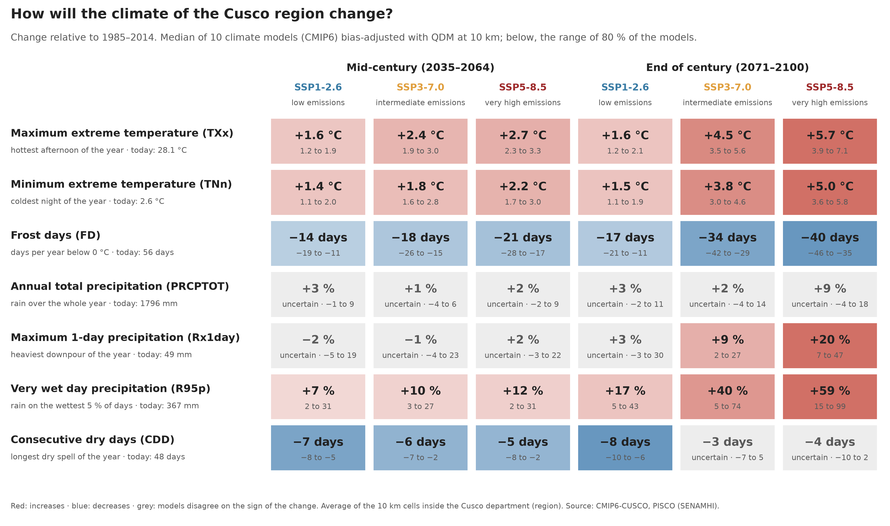
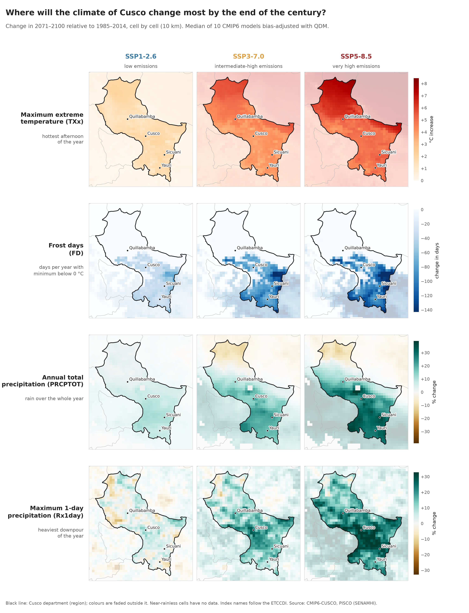
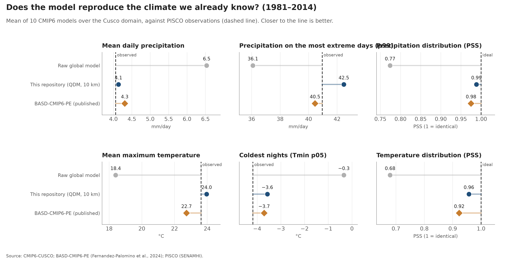
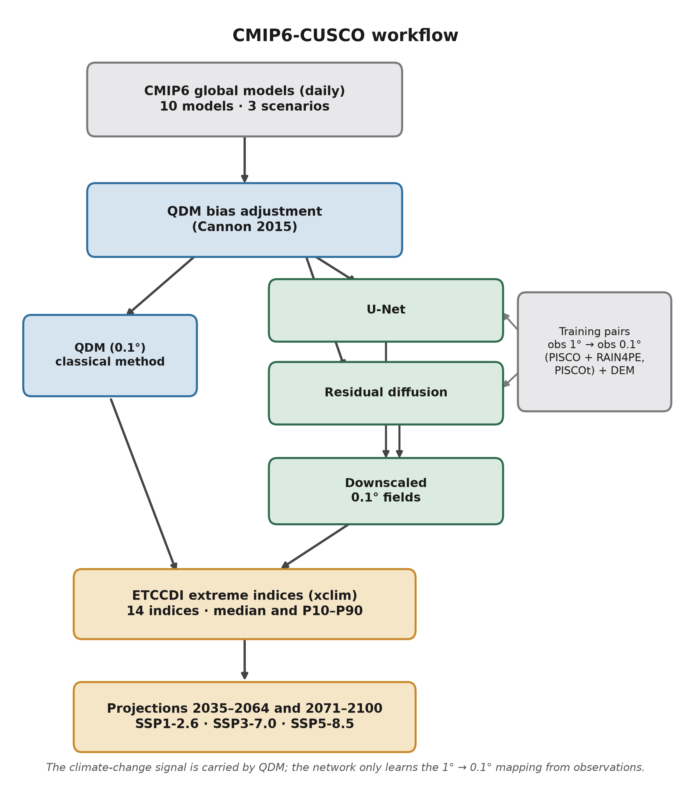
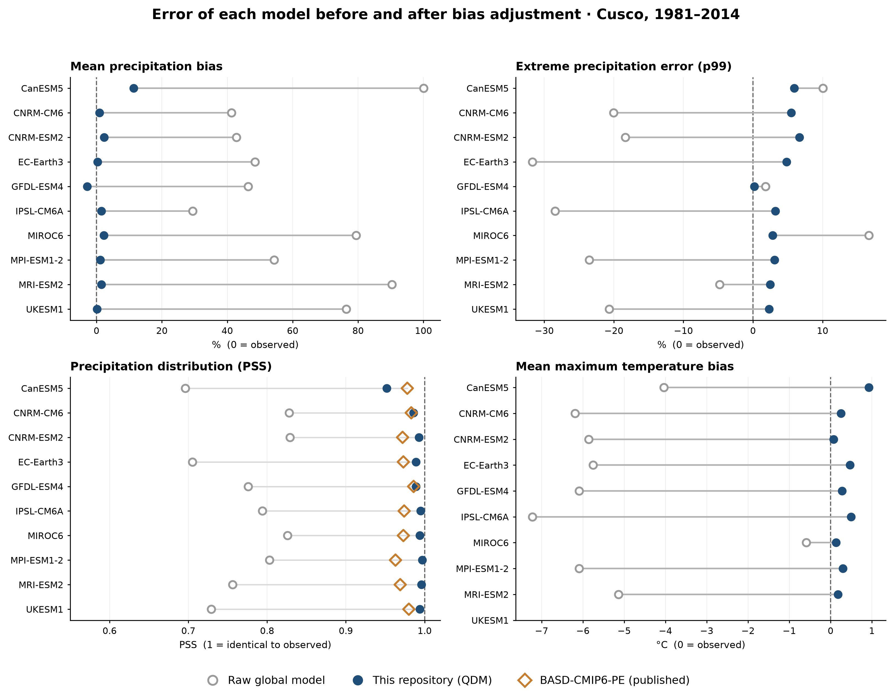
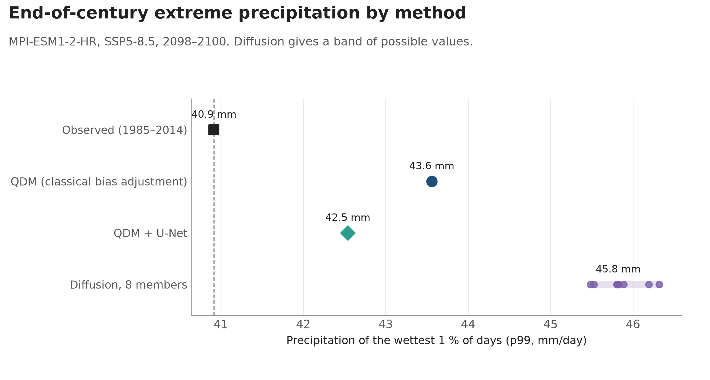
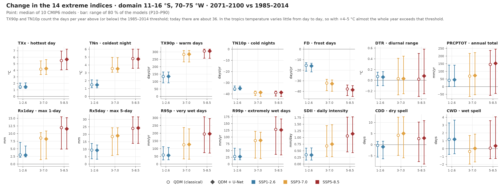

# CMIP6-CUSCO

**Future climate projections for the Cusco region (Peru) at 10 km: how much heat and heavy rainfall will increase, and how many frost days will be lost by 2050 and 2100.**

## What is it for?

Global climate models work on grids of about 100 km, where a mountain range, a valley and the Amazon lowlands are blended into a single value. As they come, they cannot be used to plan in Cusco. This repository takes 10 of those models (CMIP6, the same ones used by the IPCC), corrects their errors with 30 years of SENAMHI observations, and brings them to a 10 km grid.

The result answers questions like these, for three emission scenarios and two horizons (2035–2064 and 2071–2100):

- How much will the temperature of the hottest afternoon of the year rise?
- How many frost days will be lost?
- How much heavier will the heaviest downpour of the year be?
- Will the year be wetter or drier, and how sure are we?

Changes are measured with the ETCCDI climate extreme indices (defined by the WMO expert team on climate change detection and indices).

It is a starting point for regional and municipal adaptation plans, risk studies, environmental impact assessments, and the design of infrastructure that must last decades (irrigation, drainage, roads, bridges).

## Key findings



Figures are the average of the 616 cells of 10 km inside the Cusco department (region).

1. **It will be hotter in every scenario.** The maximum extreme temperature (TXx, the hottest afternoon of the year) rises +1.6 °C even with low emissions. With very high emissions it rises +5.7 °C by the end of the century (model range: +3.9 to +7.1 °C).
2. **There will be far fewer frost days.** Today there are 56 frost days (FD) per year on average. By the end of the century there would be 17 fewer with low emissions and 40 fewer with very high emissions. The change concentrates in the high southern provinces (Canchis, Espinar, Chumbivilcas).
3. **More rain will fall on the wettest days.** Very wet day precipitation (R95p) increases in every scenario: +7 to +12 % by mid-century and +17 to +59 % by the end. Maximum 1-day precipitation (Rx1day, the heaviest downpour of the year) only rises clearly by the end of the century with intermediate (+9 %) and very high emissions (+20 %); before that, models disagree.
4. **Annual total precipitation (PRCPTOT) is uncertain.** The median rises between +1 % and +9 %, but in every case part of the models shows a decrease. Planning should not assume more water per year.
5. **The longest dry spell shortens slightly.** Consecutive dry days (CDD, 48 today) drop by 5 to 7 days up to mid-century in all three scenarios. By the end of the century, with high emissions, models no longer agree.
6. **Scenarios diverge late in the century.** Up to 2050 the three scenarios give similar changes; afterwards they separate. Emission decisions made today matter most in the second half of the century.

### What could it mean for Cusco?

These are implications to be assessed with sector studies, not conclusions of this repository:

- **High-Andean agriculture and livestock:** fewer frosts could lengthen the growing season at high elevations, but more extreme heat increases water stress and irrigation demand.
- **Disaster risk:** more rain concentrated on the wettest days raises the likelihood of debris flows (huaicos), landslides and floods. Drainage works and bridges designed with past rainfall may fall short.
- **Water:** annual rainfall is uncertain while heat clearly increases, so evaporation will grow with more certainty than rainfall. It is prudent to plan water supply without counting on more rain.

## Where does it change most?



Each cell is about 10 km; colours are faded outside the department. With intermediate and very high emissions:

- the maximum extreme temperature rises most in the north, in the lowland forest of La Convención;
- the loss of frost days concentrates in the south and southeast (Canchis, Espinar, Chumbivilcas) and in the Cusco valley;
- annual total precipitation increases in the centre and south, and decreases slightly in the north;
- maximum 1-day precipitation increases across almost the whole department, especially in the centre.

## How reliable is it?



- **Against observations (1981–2014):** uncorrected models overestimate rainfall by +61 % on average and underestimate maximum temperature by about 5 °C. After correction, rainfall is within +1.9 % and temperature within 0.5 °C of the observations. The result is comparable to BASD-CMIP6-PE, the published product for Peru (Fernandez-Palomino et al., 2024).
- **Figures are the median of 10 models.** The range below each number shows where 80 % of the models fall. If that range includes both increases and decreases, the figure marks it as «uncertain».
- **Scenarios are not forecasts.** They describe what would happen depending on global emissions; none is more likely by default.
- **Scale:** summary figures are department averages. The department includes both highlands and lowland forest, and changes differ between them (see the maps). For a province or a basin, crop the cell data.

## Download the data

Cell-level changes (10 km) of the 14 indices, for the three scenarios and two horizons, are on the [release page](https://github.com/Cristhianbgf/CMIP6-CUSCO/releases/tag/v0.6-datos):

- `cmip6_cusco_cambio_etccdi_2050.nc` (2035–2064) and `cmip6_cusco_cambio_etccdi_2100.nc` (2071–2100);
- each index has dimensions `escenario` (scenario), `estadistico` (`p10`, `mediana` = median, `p90`), `lat` and `lon`; `<index>_obs` is the observed 1985–2014 value;
- the department table, per model and summarised, is in [`resultados/f5_departamento_cusco.csv`](resultados/f5_departamento_cusco.csv).

```python
import xarray as xr
ds = xr.open_dataset("cmip6_cusco_cambio_etccdi_2100.nc")
ds["fd"].sel(escenario="ssp585", estadistico="mediana").plot()   # change in frost days
```

The files also open in QGIS or ArcGIS. Licence CC BY 4.0: cite this repository and PISCO (SENAMHI).

## Technical details

### Method

| Step | What it does | Code |
|---|---|---|
| 1 | Evaluates the 10 GCMs of [BASD-CMIP6-PE](https://doi.org/10.5880/pik.2023.001) against PISCO over the domain | `evaluacion/gcm_ranking.py` |
| 2 | Trend-preserving QDM bias adjustment at 0.1° and comparison with BASD-CMIP6-PE | `ajuste_sesgo/qdm.py`, `evaluacion/comparacion_basd.py` |
| 3 | Super-resolution U-Net trained from 1° to 0.1° on PISCO, and residual diffusion (8 members) on top of the U-Net | `downscaling/` |
| 4 | Applies QDM to the SSP1-2.6, SSP3-7.0 and SSP5-8.5 projections | `ajuste_sesgo/qdm.py proyectar` |
| 5 | 14 ETCCDI indices (xclim) per GCM and scenario, 10-GCM ensemble and change maps | `indices/`, `figuras/` |



QDM output is aggregated to 1° before the U-Net, matching the input it was trained on, so the network adds spatial detail only once. Summary projections use QDM; QDM + U-Net gives almost identical changes (typical difference of 2 %).

### Per-model validation



### Deep learning (test period 2011–2014, daily rainfall, 1600 common cells)

| Method | RMSE (mm/d) | Wet days (%) | p99 (mm/d) | PSS |
|---|---|---|---|---|
| Observed (PISCO) | — | 51.3 | 41.5 | 1.00 |
| Bilinear interpolation | 5.59 | 62.3 | 27.4 | 0.87 |
| U-Net | 3.55 | 51.6 | 38.4 | 0.99 |
| Diffusion, 8 members | 4.06 | 64.9 | 44.1 | 0.86 |

The U-Net reproduces the rainfall distribution and underestimates p99 by 7.6 %. Diffusion does not beat it yet: it gets closer in the upper tail but overestimates wet days.



### The 14 extreme indices



The 2035–2064 version is in [`f5_cambios_ensamble_2050.png`](resultados/figuras/f5_cambios_ensamble_2050.png). These figures average the whole 11–16 °S, 70–75 °W domain, not only the department.

### Known limitations

- For temperature the U-Net gives r ≈ 1.00 against PISCOt: the task is almost trivial because PISCOt v1.2 is a smooth product, so it does not prove the network reconstructs fine temperature detail.
- Residual diffusion does not improve on the U-Net in the overall metrics; for now it is a demonstration.
- UKESM1-0-LL has no tasmax in the catalogue used: Tmax indices use 9 GCMs.
- The reference observations (PISCO) are an interpolated grid; where stations are sparse, such as the lowland forest and the summits, they also carry error.

## Repository structure

```
CMIP6-CUSCO/
├── configs/dominio.yml   # domain, periods, GCMs and scenarios
├── docs/data.md          # data sources and how to download them
├── src/cmip6cusco/
│   ├── datos/            # download and cropping (Pangeo, PISCO, BASD-CMIP6-PE)
│   ├── evaluacion/       # GCM ranking and comparison with BASD
│   ├── ajuste_sesgo/     # QDM
│   ├── downscaling/      # U-Net, diffusion, training and evaluation
│   ├── indices/          # ETCCDI with xclim and ensemble
│   └── utils/
├── figuras/              # figure scripts (shared style in figuras/estilo.py)
├── scripts/              # regeneration of the projections and data export
├── resultados/           # tables (CSV/JSON) and figures
└── tests/                # pytest: configuration, ETCCDI indices and QDM
```

Data and trained models are not versioned. Sources and how to download them are in [`docs/data.md`](docs/data.md).

## How to reproduce

```bash
conda env create -f environment.yml
conda activate cmip6-cusco
pip install -e .
pytest

# bias-adjusted projections, indices and figures (about 20 h on a PC with 6 GB of RAM; can be stopped and resumed)
python scripts/regenerar_proyecciones.py

# products and figures
python -m figuras.f5_mapas_cambio deltas 2050   # cell-level changes 2035–2064
python scripts/exportar_productos.py           # NetCDF files and department table
python -m figuras.f5_resumen
python -m figuras.f5_mapas_cambio dibujar
```

On Windows, `xarray-regrid` is used for regridding because xESMF is not available on conda-forge for Windows. See also the run notes in [`docs/data.md`](docs/data.md).

## Data sources

- PISCOp v3.0 and PISCOt v1.2 (SENAMHI), RAIN4PE and BASD-CMIP6-PE (Fernandez-Palomino et al., 2024).
- CMIP6 from the Pangeo catalogue on Google Cloud.

Each dataset keeps its own licence; this repository does not redistribute them. If you need cell-level projections for a province or a basin, open an issue in this repository.

## Author

Cristhian Brandon Gamarra Fuentes, BSc in Environmental Engineering (Universidad Andina del Cusco).

## Licence

MIT. See [LICENSE](LICENSE).
